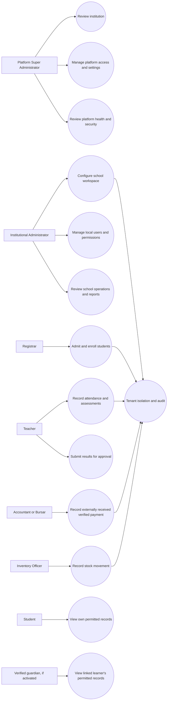
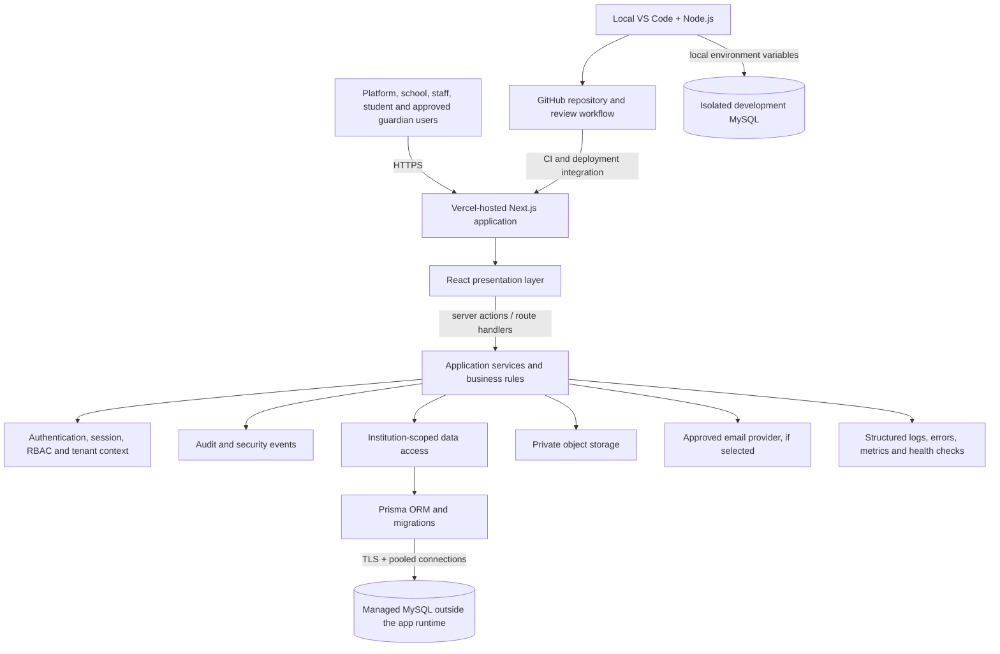
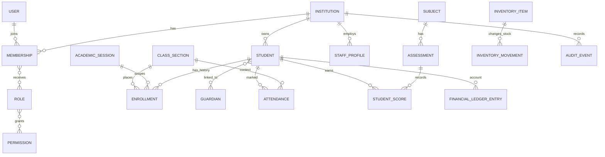

# School Vision — Phase 0 Technical Specification

**Document status:** Phase 0 proposal for owner review  
**Product:** School Vision — Intelligent School Management System (IS-SMS)  
**Initial market:** Primary and secondary schools in Monrovia, Montserrado County, Liberia  
**Initial grade coverage:** Grades 5–12  
**Prepared from:** The supplied School Vision Master Software Development Prompt  
**Implementation status:** Planning only. No application implementation is claimed by this document.

## 1. Purpose and reading guide

This document turns the master prompt into a reviewable Software Requirements Specification (SRS), architecture proposal, data-domain outline, security plan, and phased delivery plan. It uses four labels:

- **Confirmed requirement** — directly stated in the master specification.
- **Recommendation** — a proposed way to satisfy a requirement; it needs approval where it changes a major design choice.
- **Assumption** — a temporary planning premise that must be checked before the dependent implementation.
- **Unresolved decision** — an owner decision or external fact that must be settled before its dependent work.

“System must” language in the requirements sections records the supplied specification. It does not claim that the feature exists today. No database, production integration, fabricated school record, or application feature is being created as part of Phase 0.

## 2. Product understanding and boundaries

### 2.1 Product purpose

School Vision is a multi-institution school information and operations platform. Each participating school is a tenant, with its own users, settings, and records. The platform provides separate controls for School Vision platform operators and school operators. Its initial scope covers academic administration, student and staff records, attendance, financial recordkeeping, inventory, library, activities, discipline/welfare, communications, and reports for Grades 5–12.

“Intelligent” means transparent calculations, configurable institutional rules, data-quality checks, and operational alerts based on actual records. It does not authorize fabricated data, hidden estimates, or autonomous policy changes. Every statistic must identify its source, period/session, definition, and whether it is verified, calculated, estimated, missing, or incomplete.

### 2.2 In-scope capabilities

- Public product information and institutional application entry points.
- Platform administration and institution lifecycle management.
- Institution-specific user, role, permission, settings, and workspace management.
- Student and guardian profiles, admissions, enrollments, and history.
- Configurable Grades 5–12 academic structures, sessions, terms, subjects, assessment, results, and report documents.
- Student and staff attendance.
- Staff and restricted HR records.
- Fee assessment and verified payment recordkeeping. The system does **not** receive or process funds.
- Inventory, stock movements, purchasing/supplier records, valuation, and alerts.
- Library circulation, activities, discipline/welfare, communication, document/report generation.
- Data-backed dashboards, audit, security, reliability, backups, and operational reporting.
- Optional parent portal only after owner approval; parent/guardian records and controlled communications are in the required domain.
- Optional network-aware controls and gateway integrations, subject to infrastructure design and approval.

### 2.3 Explicit exclusions and constraints

- **No timetable module:** no timetable creation, period scheduling, allocation, or management.
- No payment processing, mobile money, bank, card, or cash custody by the platform.
- No automatic approval of a school based on form submission.
- No automatic change to academic, financial, or administrative policy.
- No official curriculum, assessment rule, government integration, or legal-compliance claim invented by the product team.
- No fake successful APIs, hardcoded operational dashboard totals, or sample institutional data in production.
- No microservices unless a demonstrated requirement later justifies them.
- No phase advancement until review and explicit owner approval.

## 3. Liberia-specific education reference

The master prompt specifies Primary Grades 5–6, Junior Secondary Grades 7–9, and Senior Secondary Grades 10–12. Liberia’s Ministry of Education 2022 Education Statistics report describes primary as Grades 1–6, junior secondary as Grades 7–9, and senior secondary as Grades 10–12. The requested initial coverage of 5–12 is therefore a subset spanning the end of primary through senior secondary. This supports the proposed grade grouping, but it does not establish each school’s operational structure, subject offerings, academic calendar, or grading policy. Those remain institution-configurable and need confirmation from current Ministry material and participating schools before relevant configurations are finalized. [Ministry of Education statistics report](https://www.moe.gov.lr/wp-content/uploads/2019/09/Final-EMIS_Education_Statistics_2022-4.pdf)

The Ministry currently publishes curriculum materials by grade bands, including Grades 1–6, 7–9, and 10–12. Treat these as research references for later curriculum configuration; do not copy inferred subject requirements into global defaults without review. [Ministry curriculum download](https://moe.gov.lr/curriculum-download/)

## 4. Stakeholders and user classes

| User class | Scope | Core purpose |
|---|---|---|
| Platform Super Administrator | Platform-wide administration | Review/approve institutions, administer platform operators and settings, monitor platform service and security |
| Platform administrator (delegated) | Explicitly granted platform permissions | Perform narrow platform tasks without inheriting all Super Administrator powers |
| Institutional Administrator | One assigned institution | Configure and administer that school’s operational workspace and authorized users |
| Principal / Vice Principal | Institution, permission-limited | School oversight and approved academic/administrative decisions |
| Registrar | Institution, permission-limited | Admissions, student identity, enrollment, academic records according to assigned permissions |
| Teacher | Assigned classes/subjects | View permitted learner/class information, record attendance and assessment, submit results |
| Accountant / Bursar | Institution finance | Record verified receipts and approved financial adjustments, statements and reconciliation |
| Inventory Officer | Institution inventory | Maintain items, suppliers and stock movement records |
| HR Officer | Institution HR | Maintain employment and restricted staff records |
| Librarian | Institution library | Maintain catalog and circulation records |
| Guidance/Counselling Officer | Institution restricted welfare | Maintain narrowly restricted counselling/welfare records |
| Discipline Officer | Institution restricted discipline | Record incidents, investigations, actions and notifications |
| Administrative/Reception Officer | Institution explicitly scoped | Perform assigned administrative functions only |
| Student | Own identity and authorized institution context | View permitted profile, published academic results, attendance, balance summary, announcements, documents, and submit permitted requests |
| Parent/Guardian | Verified relationship to one or more students | View only authorized information for linked students; optional portal activation awaits approval |
| Network administrator/integration identity | Defined network/integration scope | Configure or use approved network-facing integration functions; not a human school role by default |

## 5. Role and permission model

### 5.1 Platform Super Administrator vs Institutional Administrator

These are separate security boundaries and distinct account assignments. The **Platform Super Administrator** operates the School Vision service: institution review and lifecycle, platform operators, global configuration, service health, security incident oversight, and platform audit. This role does not gain routine read access to private student, medical, academic, or financial records. Exceptional access, if approved, should use a time-limited, purpose-recorded, explicitly granted, audited process.

The **Institutional Administrator** administers a single assigned school: institution configuration, staff/student/class administration, academic setup, attendance, finance records, inventory, reports, and local users, subject to finer-grained permissions and sensitive-action controls. It does not grant platform-wide institution control. A person holding both kinds of powers must have separately assigned identities/roles and a clear context switch; the application must never infer platform privileges from an institutional role.

### 5.2 Permission design

**Confirmed:** database-managed roles and permissions; institution scoping; least privilege; multiple roles where appropriate; account suspension; session revocation; permission-change auditing; inheritance only when explicitly defined.

**Recommendation:** define permissions as named actions on resources (for example, `student.read`, `student.update`, `attendance.record`, `assessment.submit`, `result.approve`, `payment.record_verified`, `financial.adjust`, `inventory.issue`, `institution.approve`). Evaluate each request on the server using identity, active session, tenant membership, role grants, resource ownership, workflow state, and any required separation-of-duty rule. Frontend visibility is only a usability aid, never authorization.

### 5.3 Permission matrix (initial proposal)

Legend: **A** administer; **W** write/operate within assigned scope; **R** read; **Own** own/linked permitted records; **—** no default access; **C** configuration/approval. Grants must be narrowed by institution, assigned class/student, workflow state, and explicit permission.

| Function / data | Platform Super Admin | Institutional Admin | Principal / VP | Registrar | Teacher | Accountant / Bursar | Inventory Officer | HR / Librarian / Welfare | Student | Guardian |
|---|---|---|---|---|---|---|---|---|---|---|
| Institution applications/lifecycle | A | — | — | — | — | — | — | — | — | — |
| Platform accounts/settings/health | A | — | — | — | — | — | — | — | — | — |
| School settings and local user grants | — | A/C | C limited | W limited | — | — | — | — | — | — |
| Student identity/admission/enrollment | — | A | R/W by grant | W | R assigned | R limited for account identification | — | Own R | Linked R if verified/allowed |
| Medical/emergency data | audited break-glass only | restricted grant | restricted grant | restricted grant | — by default | — | — | Welfare/medical grant | Own minimum necessary | Linked minimum necessary if approved |
| Staff/HR confidential data | audited break-glass only | A with restrictions | R limited | — | Own limited | — | — | HR W/R | — | — |
| Class/subject assignment | — | A | C/W | W limited | R assigned | — | — | R assigned | R assigned |
| Attendance | — | A | R/C | W if granted | W assigned class | — | — | Own R | Linked R if approved |
| Assessments/results | — | A with approval controls | R/C approval | W/R by grant | W assigned, submit | — | — | Published Own R | Published linked R if approved |
| Result approval/publication | — | C/A within school | C/W | W if granted | Submit only by default | — | — | — | — |
| Finance records/receipts/adjustments | — | A but separation recommended | R/C by grant | R limited | — | W; adjustments separately approved | — | Own balance/receipt R | Linked balance/receipt R if approved |
| Inventory/suppliers/movements | — | A | R/C | — | — | financial link R if granted | W | — | — |
| Library circulation | — | A | R | — | R/W if granted | — | Librarian W | Own R | — |
| Discipline/counselling | — | restricted A | restricted R/C | — | report/assigned limited | — | assigned welfare/discipline W | own permitted subset | notification only if approved |
| Reports/exports | platform aggregate only by default | school scope by permission | school scope by permission | student scope | assigned class scope | finance scope | stock scope | module scope | own | verified linked learner scope |
| Audit trail | platform operations; no private contents by default | own school activity scope | limited | limited | own actions | finance actions | inventory actions | module actions | own access summary (policy TBD) | own access summary (policy TBD) |

The table describes default intent, not automatic access. Owner approval and workflow-specific permissions are required before role grants are finalized. Separate preparation, approval, and posting for financial corrections; assessment submission, approval, publication, and later amendment should also be separate actions.

## 6. Functional requirements (FR)

Priority labels: **M** mandatory in the supplied scope; **P** planned but activation/depth needs owner decision; **F** future/conditional provider capability. These priorities organize the prompt and do not authorize a change in phase sequence.

### Platform tenancy and onboarding

- **FR-001 (M):** Accept school applications with the stated registered/operating names, applicable registration identifier, ownership/classification/level, location/contact, logo, authorized representative, academic structure, capacity, grades, classrooms, facilities, and operational status.
- **FR-002 (M):** Verify applicant contact details and collect supporting documents where policy requires.
- **FR-003 (M):** Track pending, under-review, approved, rejected, suspended, and deactivated states; only authorized platform actors may make approval/suspension decisions.
- **FR-004 (M):** Record onboarding decisions and changes in an auditable history.
- **FR-005 (M):** Provision an institution workspace and invite its initial administrator only after approval; support configuration and subsequent activation.
- **FR-006 (M):** Give every institution a unique, concurrency-safe human-facing identifier, suggested format `SV-LR-000001`, independent of an easily guessed primary key.
- **FR-007 (M):** Scope every institution-owned record and enforce tenant membership and resource ownership on server-side reads and writes.
- **FR-008 (M):** Keep platform operations separate from school operations; prevent routine platform staff access to confidential institutional content.

### Identity and access

- **FR-009 (M):** Authenticate users securely, manage sessions, expiration/revocation, password reset, verification where applicable, account suspension, login monitoring, and privileged-user MFA.
- **FR-010 (M):** Support institution-scoped database-managed roles and permissions, multiple roles where approved, explicit inheritance, least privilege, and audited permission changes.
- **FR-011 (M):** Allow module- and assignment-specific staff access; do not give teachers finance/payroll or accountants academic result editing by default.
- **FR-012 (M):** Provide a restricted student experience with read-only official records and permitted requests.
- **FR-013 (P):** Provide a parent/guardian portal only after approval and verified relationship binding; never expose a student based only on a claimed relationship.

### Students, staff, and academic administration

- **FR-014 (M):** Maintain student identity, guardians, emergency contact, location, admission, prior school, optional photograph, restricted medical information, documents, current grade/class/session, and longitudinal enrollment history.
- **FR-015 (M):** Support lifecycle states applicant, registered, enrolled, active, suspended, transferred, withdrawn, graduated, inactive; preserve history rather than overwrite past enrollment.
- **FR-016 (M):** Support single-entry and validated bulk import with preview, duplicate detection, row errors, and explicit commit confirmation.
- **FR-017 (M):** Support Grades 5–12 and school-configured class sections, teachers, class capacities, subjects, academic session, and promotion eligibility; do not implement timetable functions.
- **FR-018 (M):** Support institution-configured years/sessions, terms/semesters, exam and enrollment windows, publication/promotion windows, holidays/events, and historical sessions.
- **FR-019 (M):** Support subject codes/categories, grade assignment, teacher assignment, configurable credits/weighting and curriculum references without inventing official requirements.
- **FR-020 (M):** Support assessment types, subject scores, configurable grading formulas/scales/ranking, calculated grades/averages, approval/publication, report cards/transcripts, promotion decisions, reproducible calculations, revisions, and audit history.
- **FR-021 (M):** Protect submitted/approved results against unapproved edits; any correction must preserve prior value, actor, reason, time, and approval.
- **FR-022 (M):** Record student and staff attendance using the defined statuses, authorized manual entry, duplicate prevention, editor attribution, summaries, absence alerts, and historical reports.
- **FR-023 (M):** Maintain staff identity, employee identifier, position/department, qualifications/contact, employment/contract/leave, assignments, attendance, documents, and approved performance reviews with HR restrictions and lifecycle history.

### Finance and inventory

- **FR-024 (M):** Configure fee categories/structures, assessments, discounts, scholarships, waivers, verified payments, partial/overpayments, receipts, adjustments, statements, collection and balance reports.
- **FR-025 (M):** Represent payment as a school-verified record of money received outside the platform; require authorized operator, session, student, fee category, amount, date, recorded method, unique receipt, officer, verification status, and available reference.
- **FR-026 (M):** Calculate balances using decimal-safe arithmetic and explicit currency; support USD and LRD as appropriate, do not silently convert, and record only explicitly approved exchange rates.
- **FR-027 (M):** Keep a non-destructive financial history; correct through controlled reversal/adjustment entries and audit trail, never silently overwrite/delete confirmed payments.
- **FR-028 (M):** Support configurable inventory items/categories/units, opening stock, receipts, issues, returns, approved adjustments, damage/loss/expiry, threshold, supplier/purchase, valuation, reconciliation, and movement reports.
- **FR-029 (M):** Calculate stock from posted movements, record recipient/department, block negative stock unless an explicitly approved institution policy permits it, and preserve corrections as traceable movements.

### Capacity, operations, and information services

- **FR-030 (M):** Calculate approved student capacity, registered/enrolled/active/inactive counts, vacancies, utilization, grade/section/classroom totals, gender distribution where suitable, growth, withdrawals, and retention with session/reporting-period definitions.
- **FR-031 (M):** Base capacity on approved institutional/classroom/section configurations, not registered student totals; prevent division by zero and reconcile cohort totals.
- **FR-032 (M):** Manage activities, participation/completion history, statuses, date-based status signals, and authorized changes without conflating an event’s status with whether it is happening now.
- **FR-033 (M):** Manage books/copies, catalog, circulation, returns, overdue/lost/damaged state, and availability based on actual copy/loan records.
- **FR-034 (M):** Manage restricted discipline incidents, investigation, actions, resolution, and guardian notification history; restrict welfare/counselling information.
- **FR-035 (M):** Maintain parent/guardian records with many-to-many student relationships, contact preferences/history, and approved notification pathways.
- **FR-036 (M):** Support role/audience-scoped announcements, administrative notices, read/unread and notification history.
- **FR-037 (F):** Allow later email/SMS/WhatsApp Business connections only through selected and verified providers with credentials and tested integrations; do not imply they are active now.
- **FR-038 (M):** Generate permitted reports and documents from verified school data with branding, controlled document numbering, access checks, and appropriate version/history.
- **FR-039 (M):** Provide role-appropriate platform/school dashboards calculated from real records, with date range, formula/source, last-updated time; omit charts for empty datasets and show explicit empty states.
- **FR-040 (M):** Report verified/calculated/estimated/missing/incomplete status; never present an estimate as fact or manufacture completeness.

### Network, system operations, and interface

- **FR-041 (P):** Document network segmentation patterns for administrative, staff, student, server, specialized device, and guest networks. VLANs are infrastructure boundaries, not application roles.
- **FR-042 (P):** Permit configuration of trusted ranges, network restrictions, device registration/logging, and secured integration access where a compatible network and gateway are chosen; cloud hosting cannot configure a school’s switches/routers.
- **FR-043 (M):** Provide responsive, accessible role-specific navigation, validated forms, search/filter/sort/pagination where appropriate, loading/empty/error/success states, and confirmation/authorization for sensitive actions.
- **FR-044 (M):** Define real behavior for every visible control; do not show a mock action as complete.
- **FR-045 (M):** Centralize errors; use validation, constraints, duplicate prevention, transaction rollback, safe retries/idempotency, structured logs, health checks, monitoring, backups/restoration, integrity checks, and performance monitoring.

## 7. Non-functional requirements (NFR)

- **NFR-001 Security:** Protect confidentiality, integrity, and availability through layered authentication, authorization, tenant enforcement, safe defaults, audit, and security testing.
- **NFR-002 Tenant isolation:** Every tenant-scoped query/mutation is institution-bound and ownership-checked server-side. Tests must demonstrate that Tenant A cannot read/change/delete Tenant B records, including through guessed identifiers, exports, files, search, reports, and background jobs.
- **NFR-003 Data integrity:** Use relational constraints and transaction boundaries for multi-record enrollment, grade/result, finance, and inventory operations. Maintain immutable or append-only evidence where stated.
- **NFR-004 Privacy:** Minimize personal data; restrict medical, identity, financial, disciplinary, welfare, and authentication data; define access, correction, export, retention, and deletion policy before production.
- **NFR-005 Traceability:** Sensitive writes identify actor, tenant, time, action, target, outcome, and reason where appropriate. Audit records are protected against ordinary user editing/deletion.
- **NFR-006 Correctness:** Every reported total/formula is documented, reproducible, period-bound, session-bound as applicable, and sourced to records.
- **NFR-007 Availability/recovery:** Define service targets, backups, restoration objectives, deployment rollback, incident response, and recovery tests before production (targets unresolved).
- **NFR-008 Performance:** Define response-time and concurrency targets from measured usage and hosting/database limits before launch; avoid unbounded reports and uploads.
- **NFR-009 Scalability:** Start as a modular monolith with tenant-aware indexes and measured connection pools; scale application and database separately before considering service decomposition.
- **NFR-010 Maintainability:** TypeScript strict mode, named modules, documented business rules, controlled data access, minimal dependencies, code review, migration discipline, and consistent error contracts.
- **NFR-011 Usability/accessibility:** Responsive mobile/tablet/desktop, keyboard/accessibility review, accessible status and error communication, clear beginner-friendly operational guidance.
- **NFR-012 Portability/operability:** Separate local, preview, and production configuration; never reuse development data as production; keep secrets out of source control; provide logs and actionable health checks.
- **NFR-013 Localization:** Explicit institution timezone, currency, date/number formatting and potentially language needs; exact defaults require owner confirmation.
- **NFR-014 Data retention:** Historical academic, financial, HR, identity, audit, and file retention periods are policy-driven and must be decided before production.

## 8. Principal user journeys

### 8.0 Use-case overview



The diagram shows user goals and shared safeguards, not detailed screen or API design. Every use case is permission-checked and institution-scoped when it operates on school records.

### 8.1 Institution application to active workspace

1. Applicant submits institutional and representative details.
2. System validates data and verifies contact channels; application remains **pending**.
3. Applicant submits required supporting evidence if the approved policy requests it.
4. Authorized platform reviewer checks application, records decision and rationale, and approves/rejects or requests more information (whether “needs information” is a separate state is unresolved).
5. On approval, the system provisions the tenant using a concurrency-safe institution identifier and initial baseline configuration.
6. System sends a one-time, expiring administrator invitation through the selected email service; invitation is not a shared password.
7. Institutional administrator secures account, configures academic structure/calendar/grades/classes/capacity/currency/permissions, and invites staff.
8. Authorized school users enter/import verified staff and student records; imports are previewed and confirmed.
9. School confirms readiness and platform state becomes operational/active under approved activation rules.

Suspension/deactivation blocks new operational access as policy defines, preserves audit/financial/history, and requires a reason and recorded actor. Re-activation is an explicit authorized decision.

### 8.2 Student admission and enrollment

1. Registrar creates applicant or previews a validated import.
2. Duplicate checks operate on approved identifiers and review possible matches rather than destroying/merging automatically.
3. Authorized registrar verifies required information and creates the student identity.
4. Enrollment binds student + institution + academic session + grade + section + lifecycle status, subject to capacity rules.
5. Grade/session transitions create a new historical enrollment rather than overwrite old enrollment.
6. Reports count students by a published active-enrollment definition and selected session.

### 8.3 Assessment and result publication

1. Institution configures versioned grading policy for its academic context.
2. Authorized teacher records assessments for assigned subject/class and validates score ranges.
3. Teacher submits results; submitted values become protected against casual changes.
4. Authorized reviewer approves or rejects; correction requires reasoned, audited revision.
5. Results are published only during authorized workflow and become visible to permitted student/guardian users.
6. A report card recomputes from retained underlying records and policy version.

### 8.4 Verified payment record

1. Fee/charge and student account are established for the correct session/currency.
2. School receives funds outside School Vision.
3. Authorized bursar/accountant verifies receipt and records details.
4. Server validates tenant/student/account, amount, currency, status, and idempotency; transaction writes payment and ledger entry atomically.
5. System generates unique receipt and recalculates account balance.
6. Corrections are represented by separately authorized reversal/adjustment entries; statement and reports reflect the ledger history.

### 8.5 Inventory movement

1. Authorized officer records opening balance through controlled setup.
2. Receipt, issue, return, damage/loss, or adjustment is recorded as a movement with source, recipient, quantity/unit, time, and actor.
3. Server validates permitted movement and stock policy within a transaction.
4. On-hand quantity is derived from movements (or maintained as a transactionally reconciled projection); any correction creates a new auditable movement.
5. Threshold alerts compare computed on-hand stock with configured reorder point.

## 9. Capacity, strength, attendance, finance, and inventory calculation rules

All calculations belong in shared server-side domain services and must have documented definitions and tests in later implementation phases. A dashboard must never trust client-supplied totals.

### 9.1 Capacity and enrollment strength

- `approved_capacity` is a versioned institutional limit approved by an authorized school/platform policy, with documented source; it is not inferred from student count.
- Classroom capacity can be summed only for active, usable rooms and the selected school structure. Grade/section limits and school-wide approved cap may constrain the result. How to reconcile conflicting limits is an unresolved policy choice.
- Proposed formula: `available_places = max(0, approved_capacity - currently_enrolled)` and `utilization_pct = currently_enrolled / approved_capacity × 100`. If capacity is zero or unknown, show “not configured”/“not calculable,” never divide by zero or imply 0% utilization.
- “Currently enrolled” and “active student strength” must be explicitly defined by institution-approved lifecycle/session rules. Recommended default: count one valid enrollment per student per selected institution/session where status is enrolled or active; exclude applicant, withdrawn, transferred-out, graduated and inactive records unless approved policy says otherwise.
- Enforce uniqueness or conflict rules to avoid two simultaneous active section enrollments for one student in the same session. Preserve transfers and historical enrollments.
- Grade/section totals must reconcile to session total; explain duplicate, missing-session, and cross-year cases rather than conceal discrepancies.
- Growth, withdrawal, and retention denominators/time windows require approved definitions before reports are built.

### 9.2 Attendance

- Attendance is a record of an authorized marking event for student/staff, institution, date/session, and configured context (class/grade for students); it is not derivable from a timetable.
- Prevent duplicate daily/context marks using a defined uniqueness rule. Correcting a record must capture previous value, reason, actor, and time.
- Example summary: `attendance_rate = present-equivalent marks / eligible attendance marks × 100`; which statuses count as present-equivalent, how excused/suspended days and partial days work, and whether denominator uses school days are unresolved institutional policies.
- No attendance records means “no attendance data available,” not zero absences.

### 9.3 Financial balances and collections

- Use MySQL decimal types and a decimal-safe server library/strategy; avoid binary floating point. Store currency on assessed/received amounts and prohibit arithmetic across currencies without an explicitly approved rate and converted ledger record.
- Per account/currency/session, proposed balance is `assessed charges + approved debits − verified receipts − approved credits/waivers`, with each component represented by ledger entries and clear signs. Partial payment and overpayment are valid; unallocated credit handling needs approval.
- Only verified recorded receipts count as collections. Pending/unverified records do not reduce balances or count as money received.
- Never equate an opened form or attempted submission with payment. The institution, not School Vision, physically receives funds.
- Unique receipt/reference generation must be concurrency safe and auditable. Corrections use reversal/adjustment entries; no silent delete or edit of posted entries.

### 9.4 Inventory

- On-hand quantity for an item/location/unit is the sum of valid posted movements: opening + received + returned − issued − damaged/lost/expired ± approved corrections. Units must be consistent or explicitly converted through approved unit rules.
- Low-stock state is `on_hand <= configured_reorder_threshold`, with threshold and location/unit recorded. Unknown threshold is “not configured.”
- Prevent negative stock transactionally by checking and posting against the same consistent stock state. If exceptions are allowed later, require an explicit permission/policy and flag the resulting balance.
- Inventory value requires an approved costing method (such as moving average or FIFO), receipt/purchase cost provenance, currency, and treatment of damage; these remain decisions.

## 10. Multi-tenant architecture

### 10.1 Proposed tenancy model

**Recommendation:** one MySQL database and schema, shared tables, a required `institution_id` on every tenant-owned row, and a separate platform domain for global configuration/audit. This is cost-effective for the initial multi-school scale and supports transactional reporting, but its safety depends on strict query scoping, constraints, and testing. It is not a claim of native MySQL row-level security.

- Tenant-owned composite relationships should include institution identity (for example, enrollment refers to a student and class belonging to the same tenant); design unique/index keys around `(institution_id, ...)`.
- A server-side request context derives the institution from authenticated membership/selected workspace and confirms active membership. Browser-provided tenant IDs are untrusted selectors only.
- Every repository/data-access method requires a tenant context for tenant data, applies the tenant predicate, and checks resource ownership on writes. Platform operations use explicitly separate services.
- Background jobs, exports, uploads, search, notifications, and reports must carry and re-check tenant scope.
- Cross-tenant administrative access is denied by default and, if ever approved as exceptional support access, uses time-boxed authorization, justification, notice/policy, minimized scope, and immutable audit evidence.
- Do not create one database per school until scale, regulatory/data residency, or customer isolation requirements justify it; migrations/backups/analytics complexity would increase.

### 10.2 Proposed architecture diagram



### 10.3 Application layers

1. **Presentation:** React pages/components, accessibility, forms, empty/loading/error states. It does not hold secrets or connect to MySQL.
2. **Server boundary:** Next.js route handlers/server actions; authenticate, validate, authorize, rate-limit, and return controlled responses.
3. **Application/domain services:** workflows and reusable calculations (enrollment, grading, balance, inventory); no UI framework concerns.
4. **Authorization and tenant context:** checks identity + permission + tenant + resource + workflow state.
5. **Data access:** controlled Prisma queries requiring tenant context; prevents arbitrary client-controlled access.
6. **Persistence:** MySQL constraints, transactions, migrations, indexes, UTC timestamps, and historical records.
7. **Integrations:** private file storage, email/SMS providers if approved, and optional school gateway; provider boundaries are explicit.
8. **Audit/operations:** append-only business audit events, structured technical logs, metrics, health checks, backups and response process.

## 11. Technology choices and how the parts connect

The primary stack below follows the master specification. Versions and exact packages should be verified in Phase 1; no package is installed in Phase 0.

| Technology | What it does | Why proposed | Connection |
|---|---|---|---|
| TypeScript | JavaScript with compile-time type checks | Catches many data-shape mistakes early and supports strict contracts | Used by browser React and Next.js server code |
| React | Builds user interfaces from reusable components | Separates role screens/forms/tables into maintainable parts | Rendered and routed through Next.js |
| Next.js | React full-stack web framework | Hosts pages and server-side route handlers in one modular application | Receives browser requests, runs business services, talks to MySQL server-side |
| Tailwind CSS | Utility-based styling system | Provides consistent responsive styling without a separate CSS framework layer | Styles React components; not a security or data tool |
| Accessible component system | Reusable accessible controls | Improves keyboard, screen-reader, and interaction consistency | Builds on React/Tailwind; specific library is undecided and must be reviewed |
| MySQL | Relational database server | Stores connected records with constraints and transactions; familiar to owner | Queried only from server-side code through Prisma |
| Prisma ORM | Typed database query and schema tool | Makes data access and relations clearer to a beginner; produces client and migration workflow | Domain/data-access services call Prisma, which connects to MySQL |
| Prisma Migrate | Tracks schema changes as versioned migrations | Reproducible controlled database evolution | Migration files are reviewed and applied to isolated DB environments |
| Zod | Runtime input/schema validation | TypeScript types alone do not validate hostile or malformed network input | Validate server input; can share form schemas carefully |
| React Hook Form | Manages form state and validation feedback | Reduces repetitive form wiring for complex school forms | Works with React components and schemas |
| Server-side authentication library (TBD) | Secure login/session lifecycle | Avoids inventing session and cookie security | Next.js server verifies sessions before authorization/data access |
| Argon2id | Password hashing algorithm | Strong password verification without storing recoverable passwords | Authentication stores/verifies password hashes server-side |
| Git | Records code/document history | Makes changes reviewable and recoverable | Local commits are pushed to GitHub |
| GitHub | Hosts source repository and collaboration/review | Central source of truth and deployment trigger | Vercel can connect to repository for preview/production builds |
| Vercel | Builds and hosts Next.js application and preview deployments | Matches specified hosting and Next.js workflow | Serves web app; connects to separate managed database and storage using server-only secrets |
| Vitest | Unit/component-oriented test runner | Tests deterministic domain rules quickly | Tests business services and components in isolated test setup |
| Playwright | Browser end-to-end automation | Tests real navigation and user journeys | Runs against local/preview deployment and test-only isolated environment |
| Private object storage (provider TBD) | Stores uploaded documents/photos privately | Serverless app filesystems are not a private durable document store | Server issues signed/controlled access after authorization; DB stores metadata, not file bytes |
| Structured logging/error monitoring (providers TBD) | Records operational events and failures | Needed to diagnose real deployments without exposing sensitive records | Server emits redacted structured logs/metrics to approved service |

Avoid adding a cache, queue, microservice, AI model, or payment provider without an approved requirement. “Intelligence” is deterministic calculation and validation initially.

## 12. Vercel, MySQL, GitHub, and local development

### Local development

VS Code edits the repository. Node.js executes the TypeScript/Next.js development process. MySQL Server is the database process; MySQL Workbench is a graphical client used to inspect/manage that server and is not itself a database server. Local configuration points only at a development database. `.env` secrets stay untracked; `.env.example` documents variable names without credentials.

### GitHub and delivery

Git records reviewed changes. `main` is the production-ready line; `develop` and `feature/*`/`fix/*` are proposed working lines, but branch protection and exact CI workflow need approval. GitHub connects to Vercel: pushes/PRs can generate preview builds, while production deployment is restricted to approved, production-ready milestones. Deployment success does not prove correctness.

### Vercel runtime and MySQL

Vercel runs the Next.js presentation and server-side code. MySQL is a separately selected managed service; database credentials are configured as server-only environment variables. The browser never sees the connection string. Use encrypted connections, restrictive DB credentials, region proximity, backups, and a connection-pooling strategy compatible with Vercel’s function runtime. Vercel’s current guidance discusses pooling for relational databases and its marketplace currently emphasizes other database types; this means the MySQL provider and connection model need explicit selection and a deployment spike before committing to a production design. [Vercel connection-pooling guidance](https://vercel.com/kb/guide/connection-pooling-with-functions) [Vercel storage integrations](https://vercel.com/docs/marketplace-storage)

Vercel does not turn into a MySQL server, nor does cloud hosting configure school VLANs or physical network equipment. A local school gateway would be a separately secured component only if a concrete integration is approved.

### Environment separation

| Environment | Purpose | Database/data rule |
|---|---|---|
| Local | Developer learning and feature work | Isolated disposable/development records only; no real student data |
| Automated test | Repeatable unit/integration/browser tests | Test-only fixtures permitted, isolated from real institutional databases |
| Preview | Review of a milestone | Separate database/storage and secrets from production; no real data unless privacy/security policy explicitly permits |
| Production | Real school operations | Dedicated managed service, least-privilege credentials, backups, monitoring, approved migrations and rollback plan |

The exact MySQL host, region, costs, connection proxy/pool mode, database and backup plan are unresolved. Vercel-hosted web code must not depend on a developer laptop’s MySQL instance in production.

## 13. Initial database domain model and relationships

This is a domain outline, not an approved physical schema. Table names, complete columns, delete rules, indexes, and migration design require the detailed design checkpoint before Phase 3. Use internal UUIDs/opaque identifiers for externally exposed records; institution code is a separate generated display identifier.

| Domain/entity group | Main entities (conceptual) | Key relationships and constraints |
|---|---|---|
| Platform | PlatformUser, PlatformRole, PlatformPermission, GlobalSetting, PlatformAuditEvent | Platform accounts separate from tenant memberships; no automatic student-data visibility |
| Institution/onboarding | Institution, InstitutionApplication, OnboardingDecision, InstitutionStatusHistory, InstitutionConfiguration, InstitutionIdentifierSequence | Application may precede tenant activation; every decision has actor/time/reason; identifier generated safely under concurrency |
| Identity/access | User, InstitutionMembership, Role, Permission, RolePermission, MembershipRole, Session, Invitation, Credential/verification records | User may belong to multiple tenants; membership has tenant and status; platform roles separate; revoke sessions on suspension/credential changes |
| Student/guardian | Student, Guardian, StudentGuardian, StudentDocument, EmergencyContact, RestrictedMedicalRecord | Student is institution-owned; many-to-many guardian relation; verify guardian relationship before portal access; sensitive data isolated by permission |
| Staff/HR | StaffProfile, Employment, Contract, Leave, Qualification, StaffAssignment, StaffDocument, StaffAttendance | Staff belongs to one institution; restricted HR fields; retain lifecycle changes |
| Academic configuration | AcademicYear/Session, Term, CalendarEvent, GradeLevel, ClassSection, Classroom, Subject, GradeSubject, TeacherAssignment, CurriculumReference | Institution-owned configuration; sessions historical/versioned; no timetable/period entities |
| Admission/enrollment | Admission, Enrollment, EnrollmentHistory, PromotionDecision, ImportBatch/ImportRow | Enrollment links student + session + grade/section + institution; prevent conflicting active enrollments; retain history and import evidence |
| Attendance | StudentAttendance, StaffAttendance, AttendanceCorrection | Tenant/session/class/student context; uniqueness rule prevents duplicates; correction is audited |
| Assessment | AssessmentSchemeVersion, AssessmentDefinition, Assessment, StudentAssessmentScore, ResultSubmission, ResultApproval, PublishedResult/ReportSnapshot, ResultRevision | Policy version linked to calculated result; assigned teacher scope; workflow transitions lock/retain history |
| Finance | FeeCategory, FeeStructureVersion, StudentAccount, Charge, Scholarship/Discount/Waiver, FinancialLedgerEntry, PaymentRecord, Receipt, Adjustment/Reversal, ExchangeRateApproval | All tenant-scoped; decimal amount + currency; ledger entries immutable; receipt unique per approved sequence; transaction-safe posting |
| Inventory/procurement | InventoryCategory, Item, StockLocation, Supplier, Purchase, PurchaseLine, InventoryMovement, ReorderPolicy, StockCount/Reconciliation | On-hand derives from movements; unit and location explicit; posted movements immutable; negative stock policy explicit |
| Library | BookTitle, BookCopy, Author, Category, Loan, Return/LoanEvent | Copies have one current valid loan; availability derived from copy/loan state |
| Operations | Activity, ActivityParticipation, DisciplineIncident, IncidentAction, WelfareRecord, AdministrativeRequest | Sensitive discipline/welfare data restricted; activity state and dates separately represented |
| Communication | Announcement, Audience/Recipient, Notification, DeliveryAttempt, ReadReceipt, CommunicationPreference | Tenant-specific recipients and provider delivery evidence; no unsupported channel claim |
| Documents/files | DocumentMetadata, StorageObjectReference, GeneratedDocument, DocumentNumberSequence | Private object key; tenant/owner/resource ACL; virus/type/size checks; never public by default |
| Audit/operations | BusinessAuditEvent, SecurityEvent, Outbox/JobRecord, DataQualityFinding | Append-only protected events; redact secrets and unnecessary personal content; tenant carried through background jobs |

Relationships at a glance:



Key invariants: tenant IDs must agree across linked tenant rows; use foreign keys and compound uniqueness where useful; index institution/session/student/date/status access paths; use decimal financial types; persist UTC instants and render in configured timezone; prefer explicit statuses/history over destructive deletion. Soft deletion is for appropriate operational entities only and must not conceal financial/audit history.

## 14. Module inventory and dependencies

| Module | Depends on | Important outputs |
|---|---|---|
| Platform administration | Platform identity/permissions, institution lifecycle, audit, monitoring | Reviewed institutions, platform status, security oversight |
| Institution onboarding | Public entry, contact verification, document storage, platform RBAC, tenant provisioning, email provider, audit | Approved tenant and admin invitation |
| Authentication/access | User, membership, session, permission, rate limiting, audit | Secure authorized request context |
| Institution setup | Tenant permissions, academic and operational configuration | Configured school structure, capacity, currency, timezone, policies |
| Student/admission | Tenant, users, guardian, grade/session/section, documents, import validation | Student identity and historical enrollments |
| Staff/HR | Tenant, access, document storage, attendance | Staff profiles and restricted employment records |
| Academic sessions/classes/subjects | Institution configuration | Stable academic context for enrollment/attendance/results |
| Attendance | Students/staff, classes/sessions, permissions, audit | Verified marks and reports |
| Assessment/results | Academic config, subjects/teacher assignment, enrollment, permission workflow, audit | Versioned reproducible results and publication |
| Finance | Student/enrollment, session, currency/config, ledger, receipt numbering, RBAC/audit | Verified collections, balances, statements |
| Inventory | Tenant, location, units/categories, suppliers/purchases, movements, RBAC/audit | On-hand quantities, valuation, alerts |
| Library | Tenant, student/staff identity, circulation, audit | Copy availability and borrowing history |
| Activities | Tenant, audience, date/state config, participation | Activity lifecycle and participation reports |
| Discipline/welfare | Student/staff, restricted permissions, guardian/notification, audit | Restricted incident/welfare history |
| Guardians/communications | Verified student-guardian link, preferences, notices, delivery integration | Authorized messages and delivery history |
| Documents/reports | Source module, template/version, permissions, private storage | Controlled report/receipt/certificate artifacts |
| Analytics/dashboard | Domain services, session/period configuration, data quality, permission scope | Traceable role-specific metrics |
| Network integration | External school network, gateway, credentials/secrets, platform authorization | Optional policy/audit events; no direct cloud control of local equipment |

Recommended delivery order within the approved high-level phases follows these dependencies. The supplied directive says frontend before database, while also requiring real data and no fake APIs. Resolve that conflict in Section 20 before Phase 2 is planned in detail.

## 15. Security threat assessment and controls

| Risk | Example attack/failure | Proposed controls and evidence |
|---|---|---|
| Cross-institution exposure (critical) | Change `studentId`, tenant selector, report filter, file key, or export ID to access another school | Derive tenant from membership on server; mandatory tenant predicates; compound ownership checks; deny-by-default; opaque public IDs; tenant boundary tests for read/write/delete/search/report/file/background job |
| Privilege escalation (critical) | Teacher adds admin role, calls hidden endpoint, abuses stale session after permission change | Server-side named-action RBAC; protected role administration; no client trust; session revocation; MFA for privileged roles; separation of duties; permission change audit; negative authorization tests |
| Financial manipulation (critical) | Alter amount, currency, student, status, receipt number; duplicate POST; delete receipt; self-approve adjustment | Server derives account ownership; decimal types; transaction and idempotency key; append-only ledger; verified state transition; independent adjustment approval; sequence uniqueness; immutable audit; reconcile ledger vs reports |
| Academic record manipulation (critical) | Change submitted score, impersonate teacher, publish unapproved results, change grading formula retroactively | Assignment checks, policy versioning, workflow state, submit/approve/publish permissions, revisions with reason and prior value, recalculation evidence, audit and tests |
| Insecure direct object reference | Guess ID for staff/student/document | Opaque IDs plus tenant and permission checks at each operation; never rely on obscurity alone |
| Authentication/session theft | Stolen password, brute force, insecure cookie, unrevoked session | Argon2id, secure HttpOnly/SameSite cookies, expiry/rotation/revocation, MFA for privileged roles, rate limits, reset tokens with expiry, monitoring |
| Sensitive file exposure | Public bucket or forged document URL | Private storage, short-lived signed links issued after authorization, validated type/size, malware scan strategy, metadata ACL, no secrets in URLs/logs |
| XSS/CSRF/SQL injection | Malicious free text or forged browser requests | Output encoding, input validation, ORM parameterization, CSRF protection as applicable, CSP/security headers, dependency review |
| Audit tampering/repudiation | User alters or denies a sensitive action | Append-only protected audit service, actor/time/tenant/action/reason, restricted DB privileges, monitoring for event gaps; define retention and access |
| Data leakage through logs/analytics | Medical data or tokens sent to third-party monitoring | Data minimization, redaction, field-level logging policy, provider review, restricted access and retention |
| Concurrent business writes | Two admissions exceed capacity; two stock issues overspend; duplicate payment request | Database transaction/isolation strategy, unique constraints, row locking or atomic balance update, idempotency, concurrency tests |
| Misleading dashboard/automation | Stale or guessed totals treated as verified | Deterministic source queries, date/session and freshness labels, calculation glossary, empty-state rules, mismatch/data-quality flags |
| Cloud/network boundary confusion | Treat VLAN as app permission or assume Vercel manages school firewall | Document boundaries; authenticated gateway for local integration; network controls only as defense-in-depth; no browser secrets |
| Backups/ransomware/accidental deletion | Loss or corruption of tenant records | Managed backups, protected credentials, restore drills, retention policy, least privilege, migration review, rollback/runbook |
| Legal/privacy mismatch | Collect data without lawful basis, retain indefinitely, claim compliance | Data inventory/minimization, legal review in Liberia and relevant markets, approved privacy/retention/access policies; do not claim compliance before evidence |

**Security gate:** Before production, perform and document authentication, authorization, tenant isolation, SQLi/XSS/CSRF, rate-limit, session, file upload, privilege escalation, audit, backup restoration, and sensitive workflow tests. Test only with isolated automated data; do not use real student records for routine test fixtures.

## 16. Project folder structure proposal

The checked-out workspace already contains a mostly empty monorepo scaffold (`apps/`, `backend/`, `packages/`, `infrastructure/`, `scripts/`, `docs/`) plus package metadata that currently identifies the product as “U-PORT.” These are existing files/directories observed during Phase 0; the target tree below is a proposal, not an implementation status report. Prefer adapting a coherent scaffold rather than creating a second app layout.

```text
SchoolVision/
├── apps/
│   └── web/                         # Next.js application: pages, server routes, app shell
│       └── src/
│           ├── app/                 # Routes and layouts, separated by platform/school/role context
│           ├── components/          # Reusable accessible UI components
│           ├── features/            # Feature UI and client-side contracts, no direct DB access
│           └── styles/              # Global styles and tokens
├── packages/
│   ├── domain/                      # Shared domain types and deterministic rules (no UI/DB coupling)
│   ├── validation/                  # Zod input schemas and safe shared validation
│   ├── ui/                          # Shared design-system components, if workspace reuse warrants it
│   ├── config/                      # Shared TypeScript/lint/test configuration
│   └── test-support/                # Isolated test builders/fixtures; never production seed data
├── backend/                         # Optional only if a genuinely separate service is approved;
│                                    # otherwise server modules belong inside apps/web
│   └── src/                         # Keep empty/unneeded until architecture decision
├── prisma/                          # Schema, migrations, seed tooling restricted to test/dev
├── infrastructure/
│   ├── deployment/                  # Vercel/environment/deployment documentation and config
│   ├── database/                    # Local/managed DB setup, backup/restore/runbooks
│   └── network/                     # Optional gateway/VLAN integration documentation
├── scripts/                         # Safe, reviewed developer and operational scripts
├── docs/
│   ├── phase-0-technical-specification.md
│   ├── software-requirements-specification.md  # May later split from this master doc
│   ├── system-architecture.md
│   ├── database-design.md
│   ├── security-architecture.md
│   ├── api-documentation.md
│   └── decisions/                   # Accepted architecture decisions and rationale
├── .github/                         # Reviewed workflows/templates; secrets remain in GitHub/Vercel settings
├── .env.example                     # Variable names and descriptions, no actual secrets
├── .gitignore                       # Excludes secrets, build outputs, local DB files
├── package.json / pnpm-workspace.yaml / turbo.json # Workspace scripts and build orchestration
└── README.md                        # Product identity, setup guide, links to approved docs
```

Directory choices: `apps/web` owns the Next.js runtime; `packages/domain` owns reusable calculations so UI/API do not implement different formulas; `packages/validation` validates untrusted inputs; `prisma` tracks relational schema and migrations; `infrastructure` describes hosting/data/network operations; `docs` is the reviewed human reference. A separate `backend` service is not recommended unless a concrete runtime/security need appears. Final paths must be reconciled with the existing scaffold during Phase 1, without duplicating packages or installing dependencies now.

## 17. Local/project observations and identity inconsistency

During read-only Phase 0 inspection, the workspace contains empty planning Markdown files, an empty-looking monorepo layout, `README.md` titled “U-PORT,” and `package.json` name “U-PORT.” Git status also shows an untracked `.idea/` directory. This conflicts with the declared official identity “School Vision.” No code or project configuration was changed here.

**Recommendation:** Before Phase 1, decide whether the workspace is an abandoned/renamed U-PORT scaffold or an intentional predecessor. If School Vision is official, reconcile package name, README, repository/project name, and documentation consistently during the explicitly approved environment/setup phase; inspect `.idea/` ownership before deciding whether to keep or ignore it. Do not assume the current scaffold is empty of all meaningful local/user work.

## 18. Phased implementation plan and measurable gates

The phase sequence below preserves the master prompt’s ordering. Each phase stops for owner review/approval at its designated gate. These criteria are proposals for measurable evidence, not claims of completion.

| Phase | Work and exit evidence | Approval gate |
|---|---|---|
| **0 Discovery (this document)** | SRS, roles/permissions, workflows, architecture, domain model, risks, folder proposal, roadmap and decisions documented; owner decisions resolved or explicitly deferred | Owner approves Phase 0 baseline before any setup/code |
| **1 Environment/dependencies** | Record versions/status of Node, package manager, Git, MySQL Server vs Workbench, VS Code, GitHub/Vercel access; agree repository identity; `.gitignore`/`.env.example`; only approved minimal dependencies; local run/verification instructions | Owner approves verified environment |
| **2 Frontend first** | Public, platform, school admin, staff, student interfaces; parent only if approved; route inventory complete; every control has specified interaction; responsive/accessibility review; all empty/loading/error states; no fabricated real-looking activity; TypeScript/UI checks pass | Present structure and checks; owner approval before DB phase; preview is explicitly incomplete UI |
| **3 Database design and implementation** | Approved ERD, schema, tenant ownership, constraints/indexes, migrations, transaction/precision/history/identifier behavior; no production seed data; isolated tests verify constraints and tenant model; backup/restore instructions | Present tables/relationships and verification; owner approval before backend |
| **4 Backend/API** | Real authentication/session, permissions, tenant isolation, onboarding and scoped APIs; documented request/response/error contracts; audit and business logic; unit/integration/security tests cover required workflows | Explain and demonstrate; owner approval before integration |
| **5 Full integration** | Frontend connected only to real authorized endpoints; complete workflows across admissions, academic, attendance, finance, inventory, reports and communications; no disconnected controls; end-to-end evidence | Owner review of integrated journeys |
| **6 Security/QA** | Threat-driven test record covering tenant, roles, academic/financial tampering, session, validation, file handling, performance/usability and restore; all critical/high findings fixed or explicitly accepted with mitigation | Security/quality review and approval |
| **7 Production deployment** | Production database/storage/providers, secret handling, monitoring, backup, migration, domain, rollback, health checks, readiness checklist and runbooks verified in production-like setup | Explicit deployment approval required |
| **8 Institutional operational readiness** | Onboarding, admin invitation, configuration/import guides, staff training/support, recovery and school readiness procedures completed and exercised with consenting pilot school(s) | Owner approves real-school onboarding |
| **9 Final production verification** | End-to-end acceptance across approved workflows; restore exercise; tenant/security/calculation evidence; no fabricated information; monitoring and rollback; documentation complete | Only then may production-ready status be asserted |

### Phase 0 acceptance criteria

Phase 0 is reviewable when: (1) all requested modules and explicit exclusions are accounted for; (2) platform and tenant authority are separated; (3) roles, workflows, calculated metrics, security threats, and dependencies are documented; (4) MySQL/Vercel deployment tradeoffs and local/GitHub workflow are explained; (5) assumptions and owner decisions are visible; (6) phased acceptance evidence is measurable; and (7) no implementation is represented as completed. Owner approval of this document establishes the planning baseline only; it does not authorize unapproved implementation choices that are separately marked unresolved.

## 19. Assumptions and recommendations register

| ID | Type | Statement | Validate by |
|---|---|---|---|
| A-01 | Assumption | Initial use is conventional browser access by schools in Monrovia; connectivity conditions and offline needs are not yet specified | Owner and pilot schools before UX/hosting decisions |
| A-02 | Assumption | One school application maps to one institutional tenant; branches/campuses may be modeled under an institution but exact needs are unknown | Owner before onboarding and capacity design |
| A-03 | Assumption | Students/guardians have accounts only when activated, and students cannot mutate official records | Owner confirms user policy |
| A-04 | Assumption | One active primary enrollment per student/session is expected, while transfers/sections can be historically represented | Owner/pilot school before constraints |
| R-01 | Recommendation | Begin with a modular monolith in Next.js and shared-schema tenant model with mandatory tenant keys | Owner approves architecture baseline |
| R-02 | Recommendation | Treat student/financial and academic corrections as audited state transitions/append-only history | Owner approves correction and approval policy |
| R-03 | Recommendation | Treat all public IDs as opaque/unguessable; institution code is a separate human-readable code | Adopt in database design |
| R-04 | Recommendation | Keep routine platform support blind to school content; privileged emergency access must be narrow, time-limited and audited | Owner approves support policy |
| R-05 | Recommendation | Use server-side session authentication and private object storage; choose exact providers after cost, region, security and integration review | Owner selects/approves provider |
| R-06 | Recommendation | Scope dashboard metrics to explicit school/session/date and show freshness/definitions | Adopt in report glossary |

## 20. Unresolved decisions requiring owner input

These are the material Phase 0 decisions. They do not block finishing the planning document; dependent implementation must wait for answers or documented deferral.

1. **Product/workspace identity:** Confirm School Vision replaces the existing U-PORT metadata and repository scaffold, and whether the untracked `.idea/` directory should be retained/ignored.
2. **School coverage:** Does “primary and secondary, Grades 5–12” mean schools that offer some or all grades 5–12? How should schools with multiple campuses/branches, combined grade structures, or future Grades 1–4 be represented?
3. **Institution verification policy:** Which documents are required by school category; who reviews; rejection/reapplication; whether “needs more information” is a state; when a tenant becomes active; whether approval rules differ for public/private/community/faith-based schools.
4. **Institution configuration:** Who validates capacity, classroom counts, facility claims, operational status, and registration numbers? Can a school administrator edit an approved capacity or does platform review re-approval apply?
5. **Academic policies:** Required school-year/term options, attendance denominator/status meanings, grading formula versioning and ranges, ranking visibility, promotion rules, result approval chain, correction cutoff/appeal, and transcript/report formats. Obtain school-reviewed examples and authoritative references; none are fabricated here.
6. **Finance policies:** Initial currencies per institution; fee/discount/waiver approval; who verifies receipt; approval threshold/separation-of-duty for adjustments; unallocated overpayments; refund/reversal semantics; receipt numbering; exchange rates; stock valuation is separate but also requires costing decision.
7. **Parent/student accounts:** Activate parent portal now or defer? Which records can guardians see? Verification approach (school-issued code/document/manual verification), consent/age approach, communication preferences, and student identity verification.
8. **Data policy/legal:** Applicable Liberian privacy, child-protection, education-record, employment, financial-record, data residency, retention, correction/export/deletion, breach notification, and cross-border hosting requirements; designate qualified local legal review. No compliance claim can be made from this specification.
9. **Hosting/providers/budget:** MySQL service/provider/region, Vercel plan, storage provider, email provider, error/monitoring provider, expected school/user/file scale, budget, backup retention, RPO/RTO and availability targets. Vercel does not provide a first-party MySQL decision by itself.
10. **Network integration:** Is VLAN/network integration required in the first operational release or only documented as future capability? Which existing router/firewall/identity/biometric devices and whether a local gateway is actually needed?
11. **Communication channels:** Is email-only sufficient for onboarding; should email/SMS/WhatsApp be part of first launch; who pays/owns provider accounts and consent handling?
12. **Operations and support:** Platform admin count; support model; whether privileged support can ever inspect tenant records; incident escalation; institution suspension effect; data export/closure process.
13. **Deployment/branching:** Approve `main`/`develop`/feature branch policy and who can approve preview/production deployments; exact PR checks and production promotion rule.
14. **Phase sequencing conflict:** Master prompt requires frontend completion before database, yet forbids fake API/database success and defines frontend-only as a UI preview. Confirm the strict sequence means frontend shells with typed contracts and honest empty/loading states, with no fabricated data or simulated successful writes; backend/database connect only in later authorized phases. This is workable and recommended.
15. **Project organization:** The repository already has `apps/`, `backend/`, `packages/`, `infrastructure/`, and empty docs. Confirm whether the proposed single Next.js `apps/web` modular monolith is desired and whether `backend/` stays unused rather than becoming a second service.

## 21. Technical uncertainties and risks

- **Vercel + MySQL connection behavior:** Validate managed MySQL availability, TLS, pool/proxy behavior, Prisma compatibility, transaction support, region latency, and migration execution in a deployment spike before final provider selection. Connection pressure from elastic server functions can exhaust database connections without an appropriate pool.
- **Scope size:** The full prompt is a commercial school platform, not a small beginner exercise. Deliver narrow verified slices and avoid claiming full product readiness after UI-only milestones.
- **Frontend-before-database order:** Build interfaces as honest empty shells and typed contracts; no invented API success. This may limit realistic interaction review until real backend endpoints are approved.
- **Tenant isolation in a shared database:** A missing tenant predicate is a high-impact breach. Centralized tenant-bound repositories and adversarial isolation tests are mandatory; opaque IDs are supplementary only.
- **Legal and child data:** Medical, identity, disciplinary and student records need local legal and school-policy review, access minimization and retention policy before production.
- **School policy variation:** Academic structure and fees are not globally uniform; configuration schemas need school review and policy version history.
- **Human verification:** Financial collections are only as reliable as the school operator’s external cash/bank/mobile-money verification process; system audit cannot prove physical receipt.
- **Capacity provenance:** Classrooms, allowed occupancy, registered capacity and utilization may disagree. Define authorized source and reconciliation before displaying “approved capacity.”
- **Network feature mismatch:** Cloud application capabilities do not configure local VLANs; any gateway adds lifecycle, key management and support burden.
- **Data migration/import:** Identity duplicates, inconsistent spelling and incomplete historic records can distort totals; import reconciliation and provenance are necessary before onboarding real schools.
- **Observability privacy:** Error services can inadvertently collect sensitive education data; provider selection and redaction must precede production use.
- **Cost/scale unknown:** No institution count, active user count, concurrent peak, data retention or upload volume is provided; architecture is intentionally conservative until targets are known.

## 22. Glossary for a new developer

- **API:** A controlled request/response doorway through which the browser asks server code to perform an operation.
- **Authentication:** Proving who a user is, usually by verifying credentials and issuing a secure session.
- **Authorization:** Deciding what that authenticated user is permitted to do.
- **Tenant:** One customer organization—in this system, an institution/school with isolated records.
- **RBAC:** Role-based access control; permissions are grouped into roles and assigned to users.
- **ORM:** A tool (Prisma) that maps program objects/queries to relational database operations.
- **Migration:** A versioned, reviewable change to database structure.
- **Transaction:** A group of database changes that either all succeed together or all roll back.
- **Append-only ledger/history:** A record where corrections add a reversal or new event instead of erasing the original fact.
- **Idempotency:** A safeguard that makes retrying the same sensitive request avoid creating duplicate charges/payments/movements.
- **Serverless function:** Cloud code that runs to handle a request and may scale into many separate instances; database connection limits must be planned.
- **Connection pool:** A managed set of reusable database connections that reduces connection setup and connection-limit pressure.
- **MFA:** Multi-factor authentication, requiring a second proof beyond a password.
- **IDOR:** Insecure direct object reference; a flaw where changing an ID gives access to someone else’s record.
- **RPO/RTO:** Recovery Point Objective (acceptable amount of lost recent data) / Recovery Time Objective (acceptable restore duration).
- **ERD:** Entity Relationship Diagram showing database record types and how they connect.

## 23. Phase 0 outcome

This document is the Phase 0 technical proposal and review artifact. The project remains at Phase 0 until the owner reviews the specification, resolves or explicitly defers the decisions that block implementation, and gives explicit approval to begin Phase 1. No application code, dependencies, database, sample school records, or implementation claims are part of this deliverable.
